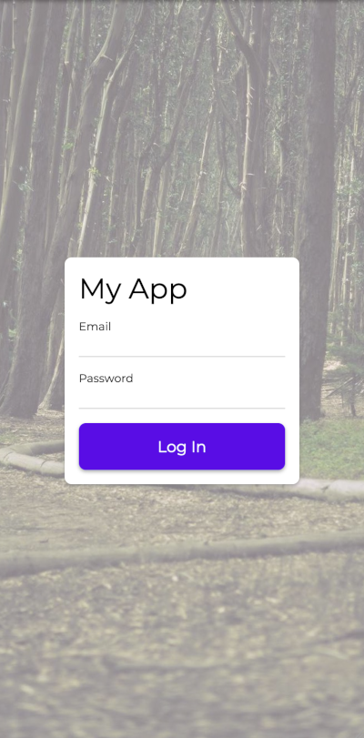
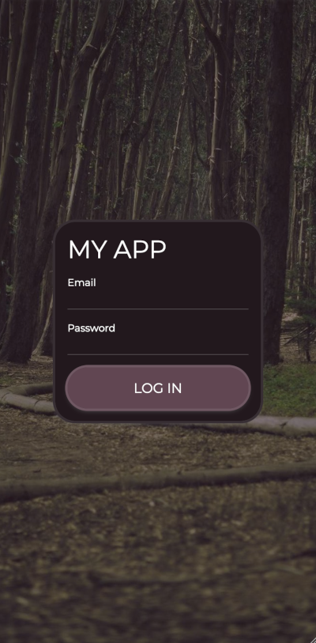

# KiteUI

[](https://central.sonatype.com/artifact/com.lightningkite.kiteui/library)
[](https://lightningkite-maven.s3.us-west-2.amazonaws.com/com/lightningkite/kiteui/library/maven-metadata.xml)
[](https://www.apache.org/licenses/LICENSE-2.0)
[](https://lightningkite-maven.s3.us-west-2.amazonaws.com/com/lightningkite/kiteui/library/docs/index.html)


A Kotlin Multiplatform UI framework with fine-grained reactivity (in the style of Solid.js) that renders with each platform's native views: the DOM on the web, `View` on Android, `UIView` on iOS, and Compose on desktop.

```kotlin
@Routable("counter")
object CounterPage : Page {
    override fun ElementWriter.CanAddTheme.render() {
        val count = Signal(0)
        val name = Signal("")
        col {
            h1("Counter")
            text { ::content { "Clicked ${count()} times" } }
            important.button {
                text("Click me")
                onClick { count.value++ }
            }
            textInput {
                hint = "Your name"
                keyboardHints = KeyboardHints.title
                content bind name
            }
            shownWhen { name().isNotBlank() }.text { ::content { "Hello, ${name()}!" } }
        }
    }
}
```

`render()` runs once.  Afterwards only the `::content { }` and `shownWhen { }` blocks rerun, and only when a signal they read changes.

## Why not Compose Multiplatform?

- **The web.**  Compose for web draws everything on a canvas, which hurts accessibility, text selection, browser features, and server-side rendering.  KiteUI emits real DOM.
- **Size.**  Compose ships its own copy of every widget.  The same Jetsnack demo is 12.2 MB with Compose for web and 0.77 MB with KiteUI, fonts and CSS included (July 2025): [Compose](https://zal.im/wasm/jetsnack) ([source](https://github.com/JetBrains/compose-multiplatform/tree/master/examples/jetsnack)) vs. [KiteUI](https://kiteui-jetsnack-demo.cs.lightningkite.com) ([source](https://github.com/lightningkite/kiteui-jetsnack-demo)).
- **URLs.**  Navigation is URL-based: `@Routable("users/{id}")` makes a page deep-linkable on the web.

Also: loading and error states flow from data to the views that show it without extra code, and themes are semantic (`important`, `danger`, `card`) rather than per-view styling.

## Install

```kotlin
// settings.gradle.kts: in both pluginManagement { } and dependencyResolutionManagement { }
repositories {
    maven("https://lightningkite-maven.s3.us-west-2.amazonaws.com")
    mavenCentral()
}

// build.gradle.kts
plugins {
    id("com.lightningkite.kiteui") version "<version>"  // generates routes, bundles resources
}
kiteui {
    packageName = "com.example.myapp"  // package of the generated AutoRoutes and Resources
}
kotlin {
    sourceSets.commonMain.dependencies {
        api("com.lightningkite.kiteui:library:<version>")
    }
}
```

See [Getting started](docs/getting-started.md) for the per-platform entry points.

| Module | What it is |
|---|---|
| `library` | The framework: web, Android, iOS, and JVM (experimental server-side rendering) |
| `library-compose` | Desktop target, rendering through Compose Multiplatform |
| `library-camera`, `library-camera-compose` | Camera preview and barcode scanning |
| `library-lottie`, `library-lottie-compose` | Lottie animations |
| `library-map` | MapLibre maps |
| `test-utilities` | UI test helpers for every platform ([Testing](docs/testing.md)) |
| `gradle-plugin` | The `com.lightningkite.kiteui` plugin: route generation and resources |
| `ai-driver-server` | Relay that lets a CLI or test drive a running app ([AI driver](docs/ai-driver.md)) |

## Learn

- **[Documentation](docs/README.md)**: a learning path from first page to testing.
- **[Example app](https://kiteui.cs.lightningkite.com/)**: every component, live; the magnifying glass shows each page's source.  The code is in [`example-app/`](example-app/).
- **[API reference (KDoc)](https://lightningkite-maven.s3.us-west-2.amazonaws.com/com/lightningkite/kiteui/library/docs/index.html)**

A login screen from the example app in two themes ([live](https://kiteui.cs.lightningkite.com/sample/login), [source](example-app/src/commonMain/kotlin/com/lightningkite/mppexampleapp/internal/SampleLogInPage.kt)):

 

## Status

In production across many Lightning Kite projects.  The API is not frozen; breaking changes come with deprecations and notes in the [CHANGELOG](CHANGELOG.md).  Server-side rendering (`jvmSsr`) is experimental, and there is no WASM target.
